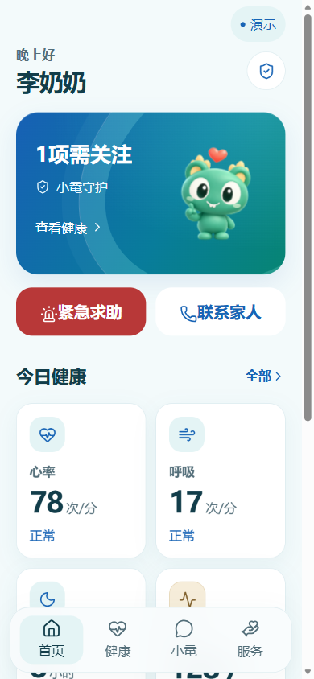

# 鼋伴伴 (YuanBan)

面向社区居家养老的「老人 / 子女 / 社区」三端协同应用：无感监测、SOS 告警、健康报告与小鼋情感陪伴。

## 技术栈

- 前端：uni-app + Vue 3 + TypeScript（`apps/mobile`）
- 后端：FastAPI + SQLite（本地）/ PostgreSQL（Docker 可选）
- 设备：MQTT 协议（模拟器 + ESP32 占位）

## 最新界面与素材

三端 H5 已统一为蓝绿主题，包含 3D 小鼋、移动优先布局、桌面侧栏，以及集中管理的演示与数据更新状态。UI 使用 Wot Design Uni、Lucide 和定制 shadcn-vue 组件。

- [蓝绿 UI 验收记录](docs/ui-aqua-acceptance.md)
- [五页设计效果图](output/ui-bluegreen-concepts/README.md)
- [3D 小鼋素材与动作](output/mascot-ip-3d/README.md)
- [三端响应式截图](output/playwright/)



仅查看演示界面时，在启动前设置 PowerShell 环境变量 `$env:VITE_USE_API = 'false'`。演示数据不用于真实健康监护或紧急救援。

本仓库保留源码、设计素材和验收记录；签名密钥、个人报告、依赖缓存与生成的 APK / 部署包不纳入版本管理。Android 构建方法见 [封装说明](apps/android/README.md)，本轮蓝绿 UI 未重新打包 APK。

## 快速开始

### 前端 H5 开发

```powershell
cd apps/mobile
pnpm install
pnpm dev:h5
```

浏览器访问 http://127.0.0.1:5180/（专用端口，避免与其它 Vite 项目的 5173 冲突）

### 后端（无 Docker）

```powershell
cd services/api
.\scripts\start-local.ps1
```

API：http://localhost:8000/docs

### 本机一键演示（API + H5）

```powershell
.\scripts\deploy-no-docker.ps1 -UseApi
```

详见 [docs/deploy-demo.md](docs/deploy-demo.md)。

### 微信小程序

```powershell
cd apps/mobile
copy .env.mp-weixin.example .env.mp-weixin
.\scripts\build-mp-weixin.ps1
```

详见 [docs/mp-weixin-setup.md](docs/mp-weixin-setup.md)。开发默认 `VITE_USE_API=true`（见 `.env.development`）。

### 阿里云服务器

公网 IP 示例：`47.102.108.137` — 部署步骤见 [docs/deploy-aliyun.md](docs/deploy-aliyun.md)。

## 目录结构

```
apps/mobile/          # uni-app 三端
services/api/         # FastAPI
services/device-simulator/
infra/                # Docker Compose（可选）
docs/                 # 产品与部署文档
```

## 文档

- [产品规划](docs/yuanbanban-product-plan.md)
- [部署说明](docs/deploy-demo.md)
- [API 对接清单](docs/api-integration-checklist.md)

## 许可证

大创 / 课程项目演示用途，具体以团队约定为准。
